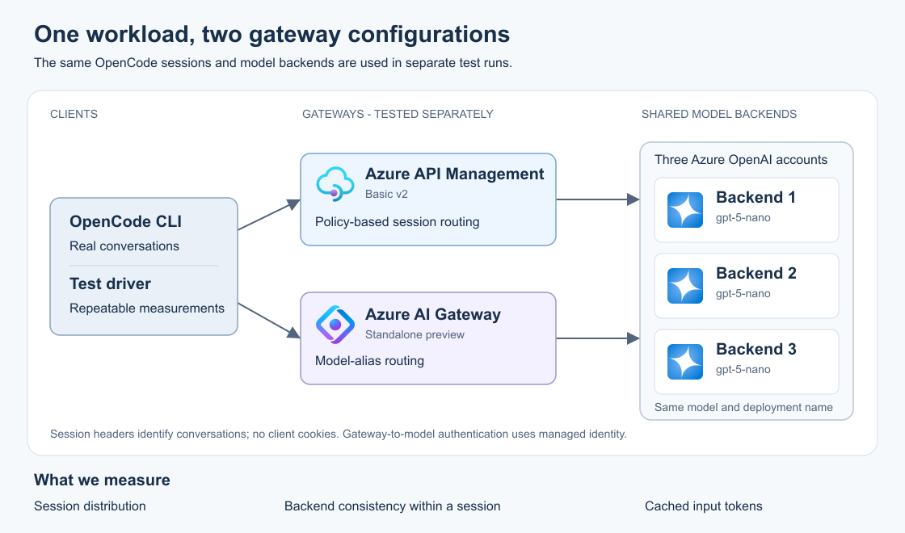

# Cookie-free LLM session affinity

**Both Azure API Management (APIM) and standalone Azure AI Gateway distributed OpenCode conversations across three LLM backends and kept each healthy conversation on the same backend, without cookies or client changes.**

All **2,160 requests** in the six routing comparisons completed. APIM's configurable policies also supplied recovery for every controlled fault request. The standalone preview's recovery scope is described below.

## The problem

Coding agents such as OpenCode send instructions, tool definitions, and a growing conversation history with each request. Much of that input remains identical across turns. **Prompt caching** lets the model service reuse computations for an identical input prefix, reducing the work required before answering.

A gateway can spread requests across several model deployments. If successive turns move between backends, cache reuse may change. The desired behavior combines two controls:

- **Load balancing:** distribute different conversations across the available backends.
- **Session affinity:** keep the turns of one conversation on its preferred backend while it is available.

OpenCode supplies a conversation identifier in its request headers, including `x-opencode-session`. Continuing a conversation preserves that identifier; starting another creates a new one. Both configurations use this existing information, so OpenCode can retain its normal cookie-free behavior.

## Architecture

Each gateway was tested against the same three Azure OpenAI accounts, each exposing an identical **gpt-5-nano** deployment, version **2025-08-07**, using **Global Standard** in Sweden Central. APIM used one **Basic v2** unit; standalone AI Gateway used **Standard preview**. Both authenticated to the models with managed identity, with model API-key authentication disabled.

The diagram is available as an [editable Inkscape SVG](docs/architecture.svg). Each gateway has a straight connection to each backend.

## Results: distribution and affinity

Each gateway was tested with a single-backend reference, ordinary balancing, and session affinity. Every case ran **60 conversations of six turns**, for 360 requests, using prompts of about 5,200 tokens and growing conversation history.

| Gateway | Routing | Initial conversations on b1 / b2 / b3 | Conversations changing backend | Warm-turn cached input |
|---|---|---|---:|---:|
| APIM | Single backend | 60 / 0 / 0 | 0 / 60 | 92.83% |
| APIM | Ordinary balancing | 22 / 22 / 16 | 60 / 60 | 90.85% |
| APIM | **Session affinity** | **20 / 23 / 17** | **0 / 60** | **88.68%** |
| AI Gateway | Single backend | 60 / 0 / 0 | 0 / 60 | 92.16% |
| AI Gateway | Ordinary balancing | 22 / 22 / 16 | 60 / 60 | 93.15% |
| AI Gateway | **Session affinity** | **19 / 25 / 16** | **0 / 60** | **91.22%** |

With affinity, both gateways distributed conversations across all three backends, with **zero backend changes within healthy conversations**. Ordinary balancing moved every conversation between backends. Serving-account identities were independently verified by matching request IDs to model diagnostics.

Warm-turn cached input is the proportion of input tokens reported as cached, excluding the first turn and weighted by tokens. Both affinity configurations stayed within five percentage points of their own single-backend reference.

### What this means for prompt caching

**Stable conversation placement is demonstrated. Additional cache savings from affinity were not established for this configuration.** Ordinary balancing also produced substantial cache reuse. Controlled requests showed cached tokens on the first request to another account endpoint after the same prompt had been sent to b1.

These Global Standard endpoints use service-managed inference placement. The physical cache location was not observable. Cache retention and routing behavior therefore require validation with the intended production model and deployment type.

## How the configurations work

### APIM: a configurable routing policy

APIM's policy engine combines conversation identification, validation, backend selection, and recovery. The policy validates OpenCode's session headers, hashes the model name and conversation identifier, and maps the result to one of the three backends. The same pair always selects the same preferred backend, with no shared session database.

Missing session headers use random backend selection. Conflicting or malformed identifiers receive HTTP 400. Recoverable errors before streaming begins can trigger another backend attempt, up to three attempts in total. This configurability supplied the controls needed for the tested routing and recovery requirements.

Implementation: [APIM policy templates](policies/) and [setup script](scripts/Set-Apim.ps1).

### Standalone AI Gateway: native affinity on a model alias

A model alias exposes one model name backed by several registered deployments. The alias uses `x-opencode-session` as its native affinity key, with **session affinity evaluated before priority**. With an unchanged backend set, the same key retains the same preferred backend.

All three registrations have equal priority and weight. A request without the session header uses ordinary balancing. The alias reads that one header; APIM additionally checks agreement between the four supported session headers.

Implementation: [AI Gateway setup script](scripts/Set-AiGateway.ps1). The [detailed configuration](docs/REPORT.md#configuration-2-standalone-azure-ai-gateway) includes the expression, alias properties, and portal settings.

## Recovery and client compatibility

For each recovery condition, six conversations made two requests while one backend was affected. The table shows completed responses out of twelve:

| Gateway | Backend returns 429 | Backend returns 503 | Backend endpoint unavailable |
|---|---:|---:|---:|
| APIM | **12 / 12** | **12 / 12** | **12 / 12** |
| AI Gateway | 10 / 12 | 10 / 12 | 8 / 12 |

APIM retried affected requests on healthy backends before streaming began. Native affinity moved subsequent turns to healthy backends after 429 and 503 responses; the initial affected requests returned those errors. The unavailable endpoint affected all four requests assigned to it.

The tested standalone preview API (**2025-09-01-preview**) excludes alias- and workspace-level fallback policies. Transparent per-request recovery for this route remains outside the verified capability. All conversations returned to their original backends after restoration. See the [recovery findings](docs/REPORT.md#pre-response-recovery) for the exact scope.

Real **OpenCode 2.2.5** completed initial turns, continuations, and new conversations through both gateways without cookies. Streaming, non-streaming, and missing-header cases were also checked; requests without a session header reached all three backends.

## Scope and next steps

The measurements cover one gateway unit, one model version, and a fixed three-backend topology. Multi-unit and multi-region operation, backend additions and removals, OpenCode compaction and subagents, and continuation after partial streamed output require separate validation. Heavily used conversations also need capacity planning because affinity concentrates their traffic on one backend.

- **[Reproduce the lab](docs/REPRODUCTION.md):** requirements, setup, test commands, evidence collection, and safe cleanup.
- **[Detailed report](docs/REPORT.md):** exact configurations, latency measurements, cache evidence, recovery scope, and production considerations.
- **[Sanitized measurement data](results/):** machine-readable evidence behind the results.
- **[Test specification](SPECIFICATION.md):** objectives and acceptance criteria.

All **seven owned resources** from the published run were deleted, and the dedicated resource group's absence was verified.

No license is specified for the original lab content. Azure service artwork follows the [Azure architecture icon terms](https://learn.microsoft.com/azure/architecture/icons/).
