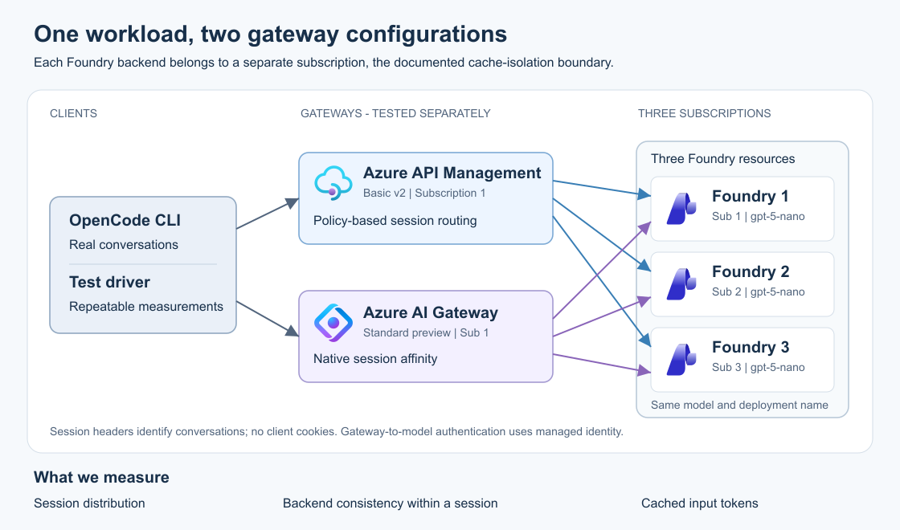

# Cookie-free LLM session affinity

**Both Azure API Management (APIM) and standalone Azure AI Gateway preserved prompt-cache reuse while distributing OpenCode conversations across three Foundry backends in separate subscriptions, without cookies or client changes.**

With affinity, warm-turn cached input was **91.87% through APIM** and **90.25% through AI Gateway**, within **0.34 percentage points** of their single-backend references. Ordinary balancing achieved about **54%**. All **720 affinity requests** completed without a conversation changing backend.

## The problem

Coding agents such as OpenCode send instructions, tool definitions, and a growing conversation history with each request. Much of that input remains identical across turns. **Prompt caching** lets the model service reuse computations for an identical input prefix, reducing the work required before answering.

A gateway can spread requests across several model deployments. If successive turns move between backends, cache reuse may change. The desired behavior combines two controls:

- **Load balancing:** distribute different conversations across the available backends.
- **Session affinity:** keep the turns of one conversation on its preferred backend while it is available.

OpenCode supplies a conversation identifier in its request headers, including `x-opencode-session`. Continuing a conversation preserves that identifier; starting another creates a new one. Both configurations use this existing information, so OpenCode can retain its normal cookie-free behavior.

## Architecture

The gateways use the same three **Foundry resources, one per Azure subscription**, each exposing an identical **gpt-5-nano** deployment, version **2025-08-07**, using **Global Standard** in Sweden Central. Both gateways and telemetry belong to the first subscription. APIM uses one **Basic v2** unit; standalone AI Gateway uses **Standard preview**. Both authenticate to the models with managed identity, with model API-key authentication disabled.

The diagram is available as an [editable Inkscape SVG](docs/architecture.svg). Each gateway has a straight connection to each backend.

## Results: distribution and affinity

Each gateway was tested with a single-backend reference, ordinary balancing, and session affinity. Every case ran **60 conversations of six turns**, for 360 requests, using prompts of about 5,200 tokens and growing conversation history.

| Gateway | Routing | Initial conversations on b1 / b2 / b3 | Conversations changing backend | Warm-turn cached input |
|---|---|---|---:|---:|
| APIM | Single backend | 60 / 0 / 0 | 0 / 60 | 92.20% |
| APIM | Ordinary balancing | 22 / 22 / 16 | 60 / 60 | 53.68% |
| APIM | **Session affinity** | **20 / 23 / 17** | **0 / 60** | **91.87%** |
| AI Gateway | Single backend | 60 / 0 / 0 | 0 / 60 | 90.59% |
| AI Gateway | Ordinary balancing | 22 / 22 / 16 | 60 / 60 | 54.48% |
| AI Gateway | **Session affinity** | **19 / 25 / 16** | **0 / 60** | **90.25%** |

With affinity, both gateways distributed conversations across all three backends, with **zero backend changes within healthy conversations**. Ordinary balancing moved every conversation between backends. Serving-account identities were independently verified by matching request IDs to model diagnostics.

Warm-turn cached input is the proportion of input tokens reported as cached, excluding the first turn and weighted by tokens. Both affinity configurations stayed within five percentage points of their own single-backend reference.

Across all six comparisons, **2,159 / 2,160 requests completed**. One ordinary-balancing AI Gateway request returned HTTP 408; its cause was not established. The zero-error comparison criterion was therefore unmet. All completed responses have token usage and independent serving-account evidence.

### What this means for prompt caching

**Affinity increased warm-turn cached input by about 36-38 percentage points compared with ordinary balancing.** Repeated visits can gradually warm several backends under ordinary balancing; affinity preserves locality from the start of the conversation.

Microsoft documents that [prompt caches are isolated between Azure subscriptions](https://learn.microsoft.com/azure/foundry/openai/how-to/prompt-caching#in-memory-prompt-cache-retention). In three controlled trials, first use on each subscription was cold (**9 / 9**), while repeated or returning requests reused cached input in **9 / 12** cases. Local cache matching remains best effort.

An earlier same-subscription control showed prompt-cache reuse across account endpoints. Separate subscriptions provide the documented isolation boundary used in this experiment.

## How the configurations work

### APIM: a configurable routing policy

APIM's policy engine combines conversation identification, validation, backend selection, and recovery. The policy validates OpenCode's session headers, hashes the model name and conversation identifier, and maps the result to one of the three backends. The same pair always selects the same preferred backend, with no shared session database.

Missing session headers use random backend selection. Conflicting or malformed identifiers receive HTTP 400. Recoverable errors before streaming begins can trigger another backend attempt, up to three attempts in total. This configurability supplied the controls needed for the tested routing and recovery requirements.

Start with the [illustrated policy walkthrough](docs/APIM-POLICY.md) to follow `session -> home -> selected-backend`. Implementation: [APIM policy templates](policies/) and [setup script](scripts/Set-Apim.ps1).

### Standalone AI Gateway: native affinity on a model alias

**AI Gateway provides a built-in affinity mechanism that we explicitly enabled and configured on the model alias.** An alias exposes one model name backed by several registered deployments. Our configuration tells the gateway to extract the conversation identifier from `x-opencode-session` using a short Common Expression Language (CEL) expression and to evaluate **session affinity before priority**.

The CEL expression returns the session key; AI Gateway handles backend selection and affinity internally. APIM's XML policy implements the backend mapping itself through SHA-256 and modulo three. In both cases, the lab explicitly configures conversation-based routing.

All three registrations have equal priority and weight. With an unchanged backend set, the same key retains the same preferred backend. A request without the session header uses ordinary balancing. The configured alias reads that one header; APIM additionally checks agreement between the four supported session headers.

Implementation: [AI Gateway setup script](scripts/Set-AiGateway.ps1). It saves the alias settings during setup; the gateway evaluates them on each request. The [detailed configuration](docs/REPORT.md#configuration-2-standalone-azure-ai-gateway) includes the exact properties and portal settings.

## Recovery and client compatibility

For each recovery condition, six conversations made two requests while one backend was affected. The table shows completed responses out of twelve:

| Gateway | Backend returns 429 | Backend returns 503 | Backend endpoint unavailable |
|---|---:|---:|---:|
| APIM | **12 / 12** | **12 / 12** | **12 / 12** |
| AI Gateway | 10 / 12 | 10 / 12 | 8 / 12 |

APIM retried affected requests on healthy backends before streaming began. Native affinity moved subsequent turns to healthy backends after 429 and 503 responses; the initial affected requests returned those errors. The unavailable endpoint affected all four requests assigned to it.

The tested standalone preview API (**2025-09-01-preview**) excludes alias- and workspace-level fallback policies. Transparent per-request recovery for this route remains outside the verified capability. All conversations returned to their original backends after restoration. See the [recovery findings](docs/REPORT.md#pre-response-recovery) for the exact scope.

Real **OpenCode 2.2.5** completed initial turns, continuations, and new conversations through both gateways without cookies. Streaming, non-streaming, and missing-header cases were also checked; requests without a session header reached all three backends.

## Scope and next steps

The measurements cover one gateway unit, one model version, and a fixed three-backend topology. Multi-unit and multi-region operation, backend additions and removals, OpenCode compaction and subagents, and continuation after partial streamed output require separate validation. Heavily used conversations also need capacity planning because affinity concentrates their traffic on one backend.

- **[Reproduce the lab](docs/REPRODUCTION.md):** requirements, setup, test commands, evidence collection, and safe cleanup.
- **[Detailed report](docs/REPORT.md):** exact configurations, latency measurements, cache evidence, recovery scope, and production considerations.
- **[Sanitized measurement data](results/):** machine-readable evidence behind the results.
- **[Test specification](SPECIFICATION.md):** objectives and acceptance criteria.

All **eight owned resources** were deleted, and the absence of all **three dedicated resource groups** was verified. The [report](docs/REPORT.md#cost-and-cleanup) and [lifecycle evidence](results/lifecycle.json) record the lab lifetime and cleanup.

No license is specified for the original lab content. Azure service artwork follows the [Azure architecture icon terms](https://learn.microsoft.com/azure/architecture/icons/).
