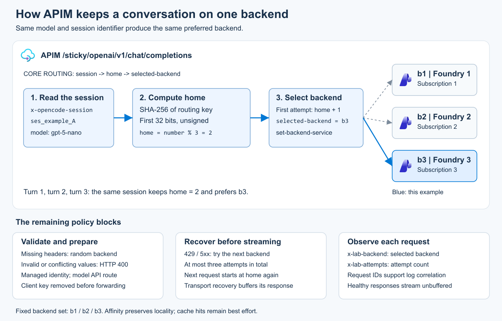

# Reading the APIM session-affinity policy

The routing core is **`session -> home -> selected-backend`**. APIM reads the conversation identifier, calculates its preferred backend, and forwards the request there. Repeating the calculation on each turn preserves placement without a shared session database or client cookies.

The full [sticky policy](../policies/sticky.xml) also handles validation, authentication, recovery, and lab measurements. This page separates those responsibilities.



[Editable Inkscape SVG](policy-flow.svg). Blue arrows show the worked example; dashed arrows show the other backend choices.

## 1. Read the conversation identifier

In `inbound`, [the header-selection expression](../policies/sticky.xml#L20) looks for these headers in order:

1. `x-opencode-session`
2. `x-opencode-session-id`
3. `x-session-affinity`
4. `x-session-id`

The first present header supplies the value saved in **`session`**. OpenCode sends the same identifier across a conversation's turns. All supplied session headers must agree; the earlier `session-error` block checks this.

## 2. Calculate the preferred backend

The [`home` expression](../policies/sticky.xml#L22) contains the actual affinity calculation. This excerpt has XML escapes decoded for readability:

```csharp
var session = (string)context.Variables["session"];
if (String.IsNullOrEmpty(session)) { return new Random().Next(0, 3); }
var model = (string)context.Request.Body.As<Newtonsoft.Json.Linq.JObject>(preserveContent: true)["model"];
var bytes = System.Security.Cryptography.SHA256.Create().ComputeHash(System.Text.Encoding.UTF8.GetBytes("lab|" + model + "|" + session));
uint number = 0;
for (var i = 0; i < 4; i++) { number = (number << 8) | bytes[i]; }
return (int)(number % 3);
```

The hash takes a fixed lab namespace, the request's `model`, and the session identifier. Its first four bytes become an unsigned, big-endian number. Dividing by three and taking the remainder produces **`home` = 0, 1, or 2**, corresponding to b1, b2, or b3.

**Same model and session -> same `home` -> same preferred backend.** The growing conversation history is outside the hash input, so adding another turn preserves the mapping. Different sessions can select the same backend; the three choices are shared among conversations.

### A worked example

For model `gpt-5-nano` and session `ses_example_A`:

| Step | Value |
|---|---|
| Hash input | `lab|gpt-5-nano|ses_example_A` |
| First four SHA-256 bytes | `39 b1 bf 87` |
| Unsigned number | `967950215` |
| `number % 3` | `2` |
| Preferred backend | **b3** |

Every turn with those same inputs starts with the same preference.

## 3. Apply the choice, with bounded retries

In `backend`, [the selection expression](../policies/sticky.xml#L42) combines `home` with the attempt counter:

```text
backend number = ((home + attempts - 1) % 3) + 1
```

`attempts` starts at zero and is incremented before selection. On the first attempt, the expression chooses `home + 1`; [`set-backend-service`](../policies/sticky.xml#L43) applies the corresponding backend entity.

For the example above:

| Attempt | Backend | When used |
|---|---|---|
| 1 | b3 | Normal first choice. |
| 2 | b1 | If a recoverable condition requires another attempt. |
| 3 | b2 | If recovery needs the final attempt. |

The initial `selected-backend = "pool"` value is overwritten before forwarding on this route. The sticky route selects b1, b2, or b3 directly.

HTTP 429 and 5xx responses can trigger another attempt before streaming begins. The next client request recalculates the original `home`: the policy retains no lasting reassignment after a retry.

## Why the rest of the policy exists

| Block | Responsibility |
|---|---|
| `session-error` | Require one value per supplied session header, agreement between headers, and 1-256 visible, non-space ASCII characters. Invalid values return HTTP 400. |
| Missing-header branch in `home` | Choose a random backend when all session headers are absent. An empty supplied header is invalid. |
| `authentication-managed-identity` and request preparation | Authenticate to Foundry, remove the client's APIM subscription key, and rewrite the model API path. |
| `retry` and `on-error` | Bound recovery to three attempts with a 45-second timeout per forwarding/recovery call. The connection-error branch buffers its recovered response; normal forwarding streams unbuffered. |
| `outbound` headers | Expose the selected backend, attempt count, chosen session header, and correlation information for lab verification. |

The connection-error recovery branch is separate from the measured normal retry path. See the [recovery findings](REPORT.md#pre-response-recovery) for what was exercised and the streaming boundary.

## Scope and source

The mapping assumes a fixed set of three ordered backends. Changing the backend count or ordering can remap conversations. Identical policies and backend mappings would allow gateway units to calculate the same preference independently; multi-unit operation still needs qualification. Cache reuse also depends on the model service's routing and retention.

The XML is generated by [`makePolicy` in policies.mjs](../scripts/policies.mjs#L9). Keep generator changes and generated policy templates consistent. The [APIM setup script](../scripts/Set-Apim.ps1) applies this policy to API `sticky`, exposed at `/sticky/openai/v1/chat/completions`.

For the wider comparison and standalone AI Gateway's native affinity setting, return to the [report](REPORT.md#configuration-2-standalone-azure-ai-gateway) or [README](../README.md).
