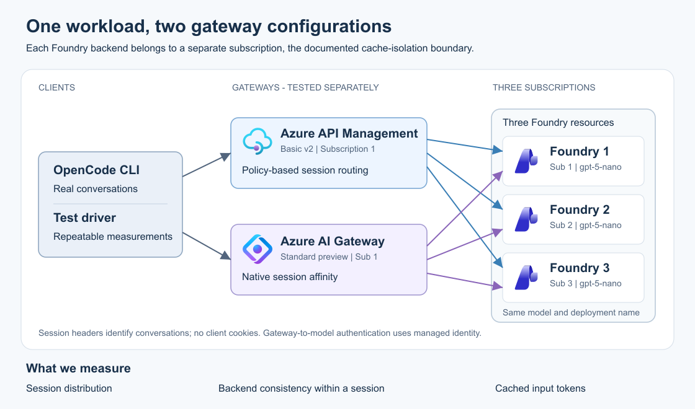

# Cookie-free LLM session affinity

**Both gateways achieved conversation affinity and preserved prompt-cache reuse across three subscription-isolated backends.** Warm-turn cached input reached **91.87% through APIM** and **90.25% through standalone AI Gateway**, versus **53.68%** and **54.48%** with ordinary balancing. Both affinity cases completed all 360 requests with zero backend changes within conversations.

APIM implements this through its configurable policy engine; standalone AI Gateway uses a built-in affinity mechanism explicitly enabled and configured on the model alias. Recovery measurements and the current preview scope are detailed below.

## The routing problem

OpenCode sends a conversation's context with each model request: instructions, tool definitions, and the growing message history. Much of that input stays identical across turns. A model service can reuse computations for an identical prompt prefix through **prompt caching**, reducing the work needed before producing the next answer.

The gateway chooses which model backend receives each request. **Load balancing** spreads work across backends; **session affinity** keeps related requests on a preferred backend. For a coding assistant, the useful unit of affinity is one conversation. Different conversations can use different backends while successive turns reuse the same backend.

Stable routing improves the opportunity for cache reuse. Actual cache hits also depend on the model service's routing, retention, and eviction behavior. We therefore measure backend consistency and cached tokens separately.

## Architecture



The two gateway configurations use the same three Foundry resources (`Microsoft.CognitiveServices/accounts`, kind `AIServices`), each in a different Azure subscription in one tenant. Every resource hosts **gpt-5-nano**, version **2025-08-07**, deployment name **gpt-5-nano**, using **Global Standard** in Sweden Central. Each backend is a deployment endpoint; Azure selects the physical inference workers behind it.

APIM uses one **Basic v2** unit. Standalone Azure AI Gateway uses **Standard preview**. Both gateways and the telemetry workspace belong to the first subscription. Each gateway's managed identity has scoped inference permissions on all three model accounts across subscriptions; model API-key authentication is disabled. Clients use ordinary gateway credentials.

The [editable SVG](architecture.svg) was rendered with Inkscape. Each gateway has a straight connection to each backend; the icons retain Microsoft's original service artwork.

## Identifying a conversation

OpenCode **2.2.5** supplies the same conversation identifier in `x-opencode-session`, `x-opencode-session-id`, `x-session-affinity`, and `x-session-id`. Continuing a conversation preserves it; a new conversation receives another identifier.

The configurations use this existing information without application changes or cookies. A project identifier would group several conversations together. A tracing identifier changes for each request. Neither gives the required conversation-level placement.

Session identifiers control placement independently of caller authentication. They should be opaque values containing no secrets or conversation content.

## Configuration 1: API Management

**APIM's configurability lets the policy combine session identification, backend selection, validation, and recovery.** The implemented policy:

1. Reads the four supported headers in the order listed above. Present values must agree and contain 1-256 visible, non-space ASCII characters; invalid or conflicting identifiers receive HTTP 400.
2. Converts the model name and conversation identifier into a number using SHA-256, then uses its remainder after division by three to select a backend. The same pair always selects the same backend; independent conversations spread across the three choices.
3. Uses ordinary random selection when no session header is present.
4. Authenticates with managed identity and forwards to the selected model deployment.
5. On recoverable errors before streaming begins, tries neighboring backends, with at most three attempts, a 45-second forward timeout, and a 180-second client deadline.

The mapping needs no shared session database. Every gateway unit would need the same policy and backend ordering; scaled operation requires separate qualification. The implemented modulo-three mapping assumes a fixed topology.

Normal responses stream without buffering. A separate transport-error recovery branch buffers its recovered response before returning it.

**Where it is applied:** API-level policies on `single`, `balanced`, and `sticky`; backend entities `b1`, `b2`, and `b3`; pool `pool`; endpoint named values `lab-endpoint-b1` through `lab-endpoint-b3`. The client route is `/sticky/openai/v1/chat/completions`. [Policy templates](../policies/) and [the setup script](../scripts/Set-Apim.ps1) contain the implementation.

The [illustrated policy walkthrough](APIM-POLICY.md) follows the session identifier through the exact routing expressions, with a worked example and a separate explanation of recovery and lab instrumentation.

## Configuration 2: standalone Azure AI Gateway

The standalone gateway provides a built-in affinity mechanism configured on a **model alias**. An alias gives the client one model name backed by several compatible model registrations. **The lab explicitly enables session-based routing and specifies how to obtain the session key.** The term *native affinity* refers to the gateway's built-in backend-affinity implementation.

Workspace `default` contains providers `b1`, `b2`, and `b3`, each registering its deployment as `lab-chat`. Alias **gpt-5-nano-sticky** includes these registrations at priority **0**, weight **1**, with automatic model selection disabled.

**Where it is applied:** on alias `gpt-5-nano-sticky`, the setup script saves these ARM properties:

```json
{
  "properties": {
    "sessionBackendPreference": {
      "key": "@cel('x-opencode-session' in request.headers ? request.headers['x-opencode-session'][0] : '')"
    },
    "selectionOrder": ["sessionBackendPreference", "priority"]
  }
}
```

`sessionBackendPreference.key` contains a Common Expression Language (CEL) expression that extracts the conversation identifier. Header names are lowercase and values are lists; `[0]` reads the supplied value. If the header is absent, the expression returns an empty string and the gateway uses ordinary balancing. `selectionOrder` places affinity before priority.

### Which part is configuration, and which part is routing logic?

| Responsibility | APIM in this lab | Standalone AI Gateway in this lab |
|---|---|---|
| Obtain the conversation identifier | XML policy reads and validates the session headers. | An alias-level CEL expression reads `x-opencode-session`. |
| Select a preferred backend consistently | Custom policy expressions calculate SHA-256, modulo three, and the backend name. | The gateway's built-in affinity mechanism uses the extracted key. |
| Apply the configuration | The setup script saves API policies. | The setup script saves alias properties. |

The CEL expression produces only a key. AI Gateway performs the backend mapping internally; the lab supplies no custom hash or backend-selection algorithm for this route. The PowerShell script runs during setup. At runtime, the gateway evaluates the saved expression and applies its routing mechanism to each request.

In the AI Gateway portal, edit this alias, enable **Session affinity**, specify the session-key expression, and choose **Session affinity before priority**. The JSON above shows the ARM representation, including its `@cel(...)` wrapper. [Set-AiGateway.ps1](../scripts/Set-AiGateway.ps1) creates the configuration through Azure CLI and ARM, then reads it back to verify persistence.

The client calls `/default/models/openai/v1/chat/completions` with `model: "gpt-5-nano-sticky"`. OpenCode's normal model setting is `lab/gpt-5-nano-sticky`; its provider configuration supplies the gateway URL and credential. This alias reads `x-opencode-session` exclusively; APIM additionally validates the other supported session headers.

### How affinity, priorities, and weights interact

The session key determines a preferred backend, including on the first request. With an unchanged backend set, the same key retains that preference. When affinity selects an available backend, weighted selection is skipped.

Priorities choose a preferred available group; lower numbers take precedence. Weights distribute requests among remaining eligible backends. Here, all priorities and weights are equal. When the session key is empty, the three backends participate in ordinary balancing.

Putting affinity before priority favors locality when different priority groups exist. If the preferred backend is unavailable or excluded, the remaining routing settings choose another eligible backend. The documented preference is retained; changing the backend set can change the mapping.

Use a separate alias for each model route so its backends provide the requested model. Affinity remains best effort, and provider-stored Responses API state needs its owning backend.

## Measurement method

Each gateway has three cases: **one backend**, **standard balancing**, and **session affinity**. Each case runs **60 six-turn sessions**, with **eleven concurrent session workers** and **36 requests/minute**. All six cases share the model accounts and run concurrently.

Synthetic prompts contain about **5,200 tokens**, stable instructions, a tool definition, and growing history. Fixed acknowledgement turns keep workloads equivalent. A unique early prefix separates every session and case. First turns must be cold.

Serving-account identity is independently checked by matching returned request IDs to model diagnostics. Missing matches remain unknown. Acceptance requires complete backend evidence, no healthy-session migrations, 20-45% of sessions on each backend, and affinity cache reuse within five percentage points of its single-backend reference.

**Cached input** is `sum(cached input tokens) / sum(total input tokens)`, weighted by tokens. Warm-cache comparisons exclude the first turn. First-token latency excludes role-only stream events; completed streams require a finish reason and final completion marker. Total and first-token latency include the network, gateway, and model. Gateway-only overhead was not isolated.

## Measured results

Of **2,160 comparative requests**, **2,159 completed**, with token usage and independent serving-account evidence for every completed response. One ordinary-balancing AI Gateway request returned HTTP **408**; its cause was not established. It remains in the published measurements, and the zero-error comparison criterion was unmet. First-turn cached tokens were zero in all six cases.

Counts below are ordered **b1 / b2 / b3**. Initial sessions describe first-turn placement; the change count describes conversations that used another backend on a later turn.

| Gateway and case | Initial sessions | Requests | Sessions changing backend | Cached input: all / warm turns |
|---|---|---|---:|---|
| APIM: single | 60 / 0 / 0 | 360 / 0 / 0 | 0 | 76.98% / 92.20% |
| APIM: balanced | 22 / 22 / 16 | 120 / 120 / 120 | 60 | 44.82% / 53.68% |
| APIM: affinity | 20 / 23 / 17 | 120 / 138 / 102 | **0** | 76.70% / 91.87% |
| AI Gateway: single | 60 / 0 / 0 | 360 / 0 / 0 | 0 | 75.63% / 90.59% |
| AI Gateway: balanced | 22 / 22 / 16 | 119 / 120 / 120 | 60 | 45.46% / 54.48% |
| AI Gateway: affinity | 19 / 25 / 16 | 114 / 150 / 96 | **0** | 75.35% / 90.25% |

Request counts and cache ratios describe completed responses. Both affinity cases meet the 20-45% session-share criterion and the five-percentage-point warm-cache tolerance against their own single-backend reference; each differs by approximately **0.33 percentage points**. APIM served 100% of affinity requests on the expected first attempt, with no retries during the comparison. Native attempt counts were not exposed.

### Latency

Times describe completed responses in milliseconds, rounded to the nearest millisecond.

| Gateway and case | First token p50 / p95 | Total p50 / p95 |
|---|---:|---:|
| APIM: single | 600 / 1043 | 714 / 1214 |
| APIM: balanced | 624 / 1151 | 744 / 1298 |
| APIM: affinity | 567 / 1032 | 699 / 1126 |
| AI Gateway: single | 419 / 874 | 538 / 970 |
| AI Gateway: balanced | 457 / 1085 | 580 / 1271 |
| AI Gateway: affinity | 426 / 917 | 546 / 1076 |

### What the cache measurements establish

**Documented boundary:** [Microsoft's prompt-caching guide](https://learn.microsoft.com/azure/foundry/openai/how-to/prompt-caching#in-memory-prompt-cache-retention) states that prompt caches are not shared between Azure subscriptions. The three Foundry resources therefore occupy separate subscriptions, with region, model, version, and deployment settings held constant.

**Controlled measurement:** each trial used a fresh approximately 5,225-token prompt and sent the identical body in the order **b1, b1, b2, b2, b3, b3, b1**. The table shows cached input tokens. Serving accounts were independently verified for all 21 completed responses.

| Trial | b1 first | b1 repeat | b2 first | b2 repeat | b3 first | b3 repeat | Return to b1 |
|---|---:|---:|---:|---:|---:|---:|---:|
| 1 | 0 | 4,992 | 0 | 4,992 | 0 | 4,992 | 0 |
| 2 | 0 | 4,992 | 0 | 0 | 0 | 4,992 | 4,992 |
| 3 | 0 | 4,992 | 0 | 0 | 0 | 4,992 | 4,992 |

First use on each subscription was cold in **9 / 9** observations. Immediate repeats reused cache in **7 / 9** cases, and returning to b1 reused it in **2 / 3**. Local misses are consistent with best-effort service routing and cache retention; physical cache ownership remains unobservable.

**Comparative result:** affinity increased warm-turn cached input by **38.19 percentage points through APIM** and **35.77 through AI Gateway**, preserving almost all the reuse achieved by each single-backend reference. Ordinary balancing can warm several backends over repeated visits, which explains its partial reuse. The short responses and shared concurrent model workload limit conclusions about latency gains; cached-token reductions were measured directly.

An earlier same-subscription control showed prompt-cache reuse across account endpoints. The current experiment uses the documented subscription isolation boundary.

### OpenCode and edge cases

Real OpenCode completed an initial turn, a continuation, and a new conversation through each gateway, both through the metadata observer and directly through normal provider settings. The observer verified the four equal session headers, stable continuation identifiers, new-conversation identifiers, and cookie-free requests. Model logs confirmed that each continued conversation stayed on its backend.

APIM passed **33** edge checks and AI Gateway passed **31**, including streaming, non-streaming, reconnection, and missing-header cases. Requests without session headers reached all three backends. APIM also checked malformed and conflicting identifiers. Compaction, title-model calls, and subagents remain outside this qualification.

### Pre-response recovery

For each condition, six sessions made two requests during the fault: two sessions normally belonged to each backend. Backend b1 was the controlled fault target. The test verified the fault condition and restored the endpoint afterward.

| Gateway | b1 returns 429 | b1 returns 503 | b1 endpoint unavailable |
|---|---:|---:|---:|
| APIM: completed responses | **12 / 12** | **12 / 12** | **12 / 12** |
| AI Gateway: completed responses | 10 / 12 | 10 / 12 | 8 / 12 |

APIM moved the two affected sessions to a healthy backend, using a second attempt for their four requests in every condition. The separate buffered recovery branch was not exercised.

With native affinity, the first two affected requests returned 429 or 503; subsequent turns used healthy backends. The unavailable-host condition returned HTTP 500 for the four affected requests. All six sessions returned to their original backends after restoration in every condition. Completed recovery responses have full model-log coverage.

**Current preview boundary:** the tested alias and workspace policy contracts exclude `fallback`; transparent per-request recovery for this route remains outside the verified capability. These bounds apply to API **2025-09-01-preview**. OpenCode's own outage retries were not measured.

## Scope and production considerations

The lab qualifies one gateway unit, one model version, and a fixed three-backend topology. Multi-unit/multi-region operation, topology changes, compaction, title-model calls, subagents, and provider-stored Responses API failover require separate validation. Transparent continuation after partial streamed output is outside the recovery guarantee.

Monitor session placement, backend load, cached-token ratios, first-token latency, errors, and recovery. Alert on unexpected healthy-session switches, sustained 429/5xx responses, and significant latency or cache-ratio deviations from baseline. A heavily used conversation concentrates work on its preferred backend; size for hot sessions and spare outage capacity. Namespace production routing keys by authenticated tenant and model route when serving multiple callers.

Cookie affinity requires client cookie handling. Semantic response caching reuses answers, and model routing selects models; conversation affinity controls backend placement. APIM supplies the tested custom validation and bounded recovery controls. Standalone AI Gateway supplies the tested placement through its explicitly configured built-in affinity, with the preview recovery boundary requiring separate production qualification.

## Cost and cleanup

The lab lifetime was approximately **68 minutes**. The public Sweden Central APIM Basic v2 capacity quote was **US$0.27 per unit-hour**, giving a capacity-planning upper bound of about **US$0.31** for that window. Inference, AI Gateway, and telemetry charges are separate; an invoiced total was not collected.

All **eight inventoried resources** had the expected ownership tags: three Foundry accounts, two gateways, a workspace, Application Insights, and its Smart Detection action group. The three dedicated resource groups were deleted and their absence verified in every subscription. Cleanup deleted only owned lab groups; subscription-level provider registrations and platform soft-delete records were retained. Manifests and raw evidence remain excluded from Git.

See the [README](../README.md) for the overview, the [reproduction guide](REPRODUCTION.md) for setup and cleanup, the [specification](../SPECIFICATION.md) for acceptance criteria, and [sanitized results](../results/) for machine-readable evidence.

## Primary references

- [Standalone Azure AI Gateway](https://learn.microsoft.com/azure/ai-gateway/overview), [native session affinity](https://ai.gateway.azure.com/docs/models/session-affinity), [configuration guide](https://ai.gateway.azure.com/docs/models/guides/configure-session-affinity), and [routing order](https://ai.gateway.azure.com/docs/models/routing-order).
- [APIM backend pools](https://learn.microsoft.com/azure/api-management/backends) and [policy expressions](https://learn.microsoft.com/azure/api-management/api-management-policy-expressions).
- [Azure OpenAI prompt caching](https://learn.microsoft.com/azure/foundry/openai/how-to/prompt-caching).
- [OpenCode 2.2.5](https://github.com/anomalyco/opencode/releases/tag/v2.2.5) and [Azure architecture icon terms](https://learn.microsoft.com/azure/architecture/icons/).
- [Azure Retail Prices API](https://learn.microsoft.com/rest/api/cost-management/retail-prices/azure-retail-prices).
