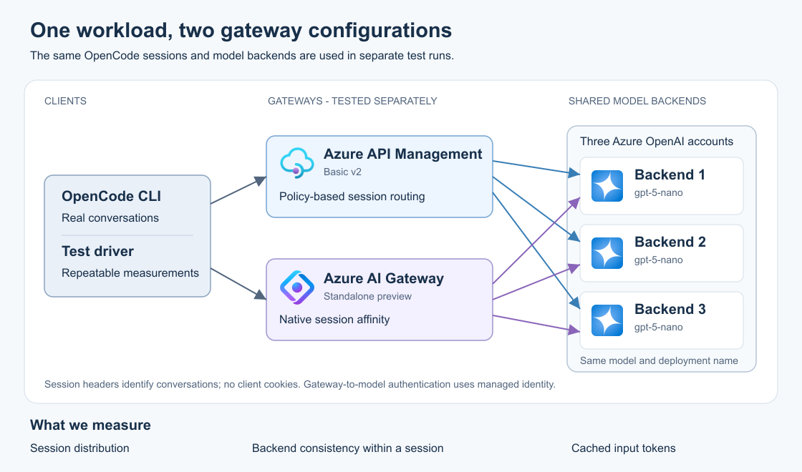

# Cookie-free LLM session affinity

**Both gateways achieved the core routing objective:** independent OpenCode conversations were distributed across three backends, with zero backend changes within healthy conversations. APIM implements this through its configurable policy engine; standalone AI Gateway provides native header-based affinity.

APIM also completed every controlled pre-response recovery request. The standalone preview has a narrower verified recovery scope, detailed below. Additional cache savings from affinity were not demonstrated with this model configuration.

## The routing problem

OpenCode sends a conversation's context with each model request: instructions, tool definitions, and the growing message history. Much of that input stays identical across turns. A model service can reuse computations for an identical prompt prefix through **prompt caching**, reducing the work needed before producing the next answer.

The gateway chooses which model backend receives each request. **Load balancing** spreads work across backends; **session affinity** keeps related requests on a preferred backend. For a coding assistant, the useful unit of affinity is one conversation. Different conversations can use different backends while successive turns reuse the same backend.

Stable routing improves the opportunity for cache reuse. Actual cache hits also depend on the model service's routing, retention, and eviction behavior. We therefore measure backend consistency and cached tokens separately.

## Architecture



The two gateway configurations use the same three Azure OpenAI accounts. Every account hosts **gpt-5-nano**, version **2025-08-07**, deployment name **gpt-5-nano**, using **Global Standard** in Sweden Central. Each backend is a deployment endpoint; Azure selects the physical inference workers behind it.

APIM uses one **Basic v2** unit. Standalone Azure AI Gateway uses **Standard preview**. Both authenticate to the model accounts with managed identity and scoped inference permissions; model API-key authentication is disabled. Clients use ordinary gateway credentials.

The [editable SVG](architecture.svg) was rendered with Inkscape. Each gateway has a straight connection to each backend; the icons retain Microsoft's original service artwork.

## Identifying a conversation

OpenCode **2.2.5** supplies the same conversation identifier in `x-opencode-session`, `x-opencode-session-id`, `x-session-affinity`, and `x-session-id`. Continuing a conversation preserves it; a new conversation receives another identifier.

The configurations use this existing information without application changes or cookies. A project identifier would group several conversations together. A tracing identifier changes for each request. Neither gives the required conversation-level placement.

Session identifiers control placement independently of caller authentication. They should be opaque values containing no secrets or conversation content.

## Configuration 1: API Management

**APIM's configurability lets the policy combine session identification, backend selection, validation, and recovery.** The implemented policy:

1. Reads the four supported headers in the order listed above. Present values must agree and contain 1-256 visible, non-space ASCII characters; invalid or conflicting identifiers receive HTTP 400.
2. Converts the model name and conversation identifier into a number using SHA-256, then uses its remainder after division by three to select a backend. The same pair always selects the same backend; independent conversations spread across the three choices.
3. Uses ordinary random selection when no session header is present.
4. Authenticates with managed identity and forwards to the selected model deployment.
5. On recoverable errors before streaming begins, tries neighboring backends, with at most three attempts, a 45-second forward timeout, and a 180-second client deadline.

The mapping needs no shared session database. Every gateway unit would need the same policy and backend ordering; scaled operation requires separate qualification. The implemented modulo-three mapping assumes a fixed topology.

Normal responses stream without buffering. A separate transport-error recovery branch buffers its recovered response before returning it.

**Where it is applied:** API-level policies on `single`, `balanced`, and `sticky`; backend entities `b1`, `b2`, and `b3`; pool `pool`; endpoint named values `lab-endpoint-b1` through `lab-endpoint-b3`. The client route is `/sticky/openai/v1/chat/completions`. [Policy templates](../policies/) and [the setup script](../scripts/Set-Apim.ps1) contain the implementation.

## Configuration 2: standalone Azure AI Gateway

The standalone gateway implements affinity directly on a **model alias**. An alias gives the client one model name backed by several compatible model registrations.

Workspace `default` contains providers `b1`, `b2`, and `b3`, each registering its deployment as `lab-chat`. Alias **gpt-5-nano-sticky** includes these registrations at priority **0**, weight **1**, with automatic model selection disabled.

Its session key uses this Common Expression Language (CEL) expression:

```cel
'x-opencode-session' in request.headers ? request.headers['x-opencode-session'][0] : ''
```

Header names are lowercase and values are lists; `[0]` reads the supplied value. The expression returns an empty string when the header is absent, allowing ordinary balancing.

**Where it is applied:** on the alias, `properties.sessionBackendPreference.key` contains the expression wrapped in `@cel(...)`, and `properties.selectionOrder` is:

```json
["sessionBackendPreference", "priority"]
```

In the AI Gateway portal, edit this alias, enable **Session affinity**, enter the expression, and choose **Session affinity before priority**. [Set-AiGateway.ps1](../scripts/Set-AiGateway.ps1) creates the configuration through Azure CLI and ARM, then reads it back to verify persistence.

The client calls `/default/models/openai/v1/chat/completions` with `model: "gpt-5-nano-sticky"`. OpenCode's normal model setting is `lab/gpt-5-nano-sticky`; its provider configuration supplies the gateway URL and credential. This alias reads `x-opencode-session` exclusively; APIM additionally validates the other supported session headers.

### How affinity, priorities, and weights interact

The session key determines a preferred backend, including on the first request. With an unchanged backend set, the same key retains that preference. When affinity selects an available backend, weighted selection is skipped.

Priorities choose a preferred available group; lower numbers take precedence. Weights distribute requests among remaining eligible backends. Here, all priorities and weights are equal. When the session key is empty, the three backends participate in ordinary balancing.

Putting affinity before priority favors locality when different priority groups exist. If the preferred backend is unavailable or excluded, the remaining routing settings choose another eligible backend. The documented preference is retained; changing the backend set can change the mapping.

Use a separate alias for each model route so its backends provide the requested model. Affinity remains best effort, and provider-stored Responses API state needs its owning backend.

## Measurement method

Each gateway has three cases: **one backend**, **standard balancing**, and **session affinity**. Each case runs **60 six-turn sessions**, with **eleven concurrent session workers** and **36 requests/minute**. All six cases share the model accounts and run concurrently.

Synthetic prompts contain about **5,200 tokens**, stable instructions, a tool definition, and growing history. Fixed acknowledgement turns keep workloads equivalent. A unique early prefix separates every session and case. First turns must be cold.

Serving-account identity is independently checked by matching returned request IDs to model diagnostics. Missing matches remain unknown. Acceptance requires complete backend evidence, no healthy-session migrations, 20-45% of sessions on each backend, and affinity cache reuse within five percentage points of its single-backend reference.

**Cached input** is `sum(cached input tokens) / sum(total input tokens)`, weighted by tokens. Warm-cache comparisons exclude the first turn. First-token latency excludes role-only stream events; completed streams require a finish reason and final completion marker. Total and first-token latency include the network, gateway, and model. Gateway-only overhead was not isolated.

## Measured results

All **2,160 comparative requests completed**, with token usage and independent serving-account evidence for every request. First-turn cached tokens were zero in all six cases.

Counts below are ordered **b1 / b2 / b3**. Initial sessions describe first-turn placement; the change count describes conversations that used another backend on a later turn.

| Gateway and case | Initial sessions | Requests | Sessions changing backend | Cached input: all / warm turns |
|---|---|---|---:|---|
| APIM: single | 60 / 0 / 0 | 360 / 0 / 0 | 0 | 77.51% / 92.83% |
| APIM: balanced | 22 / 22 / 16 | 120 / 120 / 120 | 60 | 75.85% / 90.85% |
| APIM: affinity | 20 / 23 / 17 | 120 / 138 / 102 | **0** | 74.04% / 88.68% |
| AI Gateway: single | 60 / 0 / 0 | 360 / 0 / 0 | 0 | 76.95% / 92.16% |
| AI Gateway: balanced | 22 / 22 / 16 | 120 / 120 / 120 | 60 | 77.77% / 93.15% |
| AI Gateway: affinity | 19 / 25 / 16 | 114 / 150 / 96 | **0** | 76.16% / 91.22% |

Both affinity cases meet the 20-45% session-share criterion and the five-percentage-point warm-cache tolerance against their own single-backend reference. APIM served 100% of affinity requests on the expected first attempt, with no retries during the comparison. Native attempt counts were not exposed.

### Latency

Times are milliseconds, rounded to the nearest millisecond.

| Gateway and case | First token p50 / p95 | Total p50 / p95 |
|---|---:|---:|
| APIM: single | 517 / 693 | 598 / 769 |
| APIM: balanced | 477 / 612 | 558 / 700 |
| APIM: affinity | 483 / 608 | 566 / 705 |
| AI Gateway: single | 340 / 508 | 420 / 601 |
| AI Gateway: balanced | 341 / 474 | 421 / 557 |
| AI Gateway: affinity | 331 / 459 | 413 / 551 |

### What the cache measurements establish

**Measured:** standard balancing also produced substantial cache reuse. In three controlled trials, an identical request first sent to b1 had zero cached tokens; its first requests to b2 and b3 each reported **4,992 cached tokens**. Returning to b1 reused 4,992 tokens in two trials and reported zero in one. All serving accounts were independently verified.

**Interpretation:** these same-subscription Global Standard endpoints provided cache reuse across account endpoints. Physical cache ownership was not observable. Affinity's routing benefit is demonstrated; an additional cache-saving benefit requires validation with the intended production model and deployment type.

### OpenCode and edge cases

Real OpenCode completed an initial turn, a continuation, and a new conversation through each gateway, both through the metadata observer and directly through normal provider settings. The observer verified the four equal session headers, stable continuation identifiers, new-conversation identifiers, and cookie-free requests. Model logs confirmed that each continued conversation stayed on its backend.

APIM passed **33** edge checks and AI Gateway passed **31**, including streaming, non-streaming, reconnection, and missing-header cases. Requests without session headers reached all three backends. APIM also checked malformed and conflicting identifiers. Compaction, title-model calls, and subagents remain outside this qualification.

### Pre-response recovery

For each condition, six sessions made two requests during the fault: two sessions normally belonged to each backend. Backend b1 was the controlled fault target. The test verified the fault condition and restored the endpoint afterward.

| Gateway | b1 returns 429 | b1 returns 503 | b1 endpoint unavailable |
|---|---:|---:|---:|
| APIM: completed responses | **12 / 12** | **12 / 12** | **12 / 12** |
| AI Gateway: completed responses | 10 / 12 | 10 / 12 | 8 / 12 |

APIM moved the two affected sessions to a healthy backend, using a second attempt for their four requests in every condition. The separate buffered recovery branch was not exercised.

With native affinity, the first two affected requests returned 429 or 503; subsequent turns used healthy backends. The unavailable-host condition returned HTTP 500 for the four affected requests. All six sessions returned to their original backends after restoration in every condition. Completed recovery responses have full model-log coverage.

**Current preview boundary:** the tested alias and workspace policy contracts exclude `fallback`; transparent per-request recovery for this route remains outside the verified capability. Registered-model fallback settings did not extend recovery through the alias. These bounds apply to API **2025-09-01-preview**. OpenCode's own outage retries were not measured.

## Scope and production considerations

The lab qualifies one gateway unit, one model version, and a fixed three-backend topology. Multi-unit/multi-region operation, topology changes, compaction, title-model calls, subagents, and provider-stored Responses API failover require separate validation. Transparent continuation after partial streamed output is outside the recovery guarantee.

Monitor session placement, backend load, cached-token ratios, first-token latency, errors, and recovery. Alert on unexpected healthy-session switches, sustained 429/5xx responses, and significant latency or cache-ratio deviations from baseline. A heavily used conversation concentrates work on its preferred backend; size for hot sessions and spare outage capacity. Namespace production routing keys by authenticated tenant and model route when serving multiple callers.

Cookie affinity requires client cookie handling. Semantic response caching reuses answers, and model routing selects models; conversation affinity controls backend placement. APIM supplies the tested custom validation and bounded recovery controls. Native AI Gateway supplies the tested header-based placement, with the preview recovery boundary requiring separate production qualification.

## Cost and cleanup

The lab lifetime was approximately **83 minutes**. The public Sweden Central APIM Basic v2 capacity quote was **US$0.27 per unit-hour**, giving a capacity-planning upper bound of about **US$0.38** for that window. Inference, AI Gateway, and telemetry charges are separate; an invoiced total was not collected.

All **seven inventoried resources** had the expected ownership tags and belonged to the dedicated group. The group was deleted and its absence verified. Cleanup deleted only the owned lab group; subscription-level provider registrations and platform soft-delete records were retained. Manifests and raw evidence remain excluded from Git.

See the [README](../README.md) for reproduction and cleanup, the [specification](../SPECIFICATION.md) for acceptance criteria, and [sanitized results](../results/) for machine-readable evidence.

## Primary references

- [Standalone Azure AI Gateway](https://learn.microsoft.com/azure/ai-gateway/overview), [native session affinity](https://ai.gateway.azure.com/docs/models/session-affinity), [configuration guide](https://ai.gateway.azure.com/docs/models/guides/configure-session-affinity), and [routing order](https://ai.gateway.azure.com/docs/models/routing-order).
- [APIM backend pools](https://learn.microsoft.com/azure/api-management/backends) and [policy expressions](https://learn.microsoft.com/azure/api-management/api-management-policy-expressions).
- [Azure OpenAI prompt caching](https://learn.microsoft.com/azure/foundry/openai/how-to/prompt-caching).
- [OpenCode 2.2.5](https://github.com/anomalyco/opencode/releases/tag/v2.2.5) and [Azure architecture icon terms](https://learn.microsoft.com/azure/architecture/icons/).
- [Azure Retail Prices API](https://learn.microsoft.com/rest/api/cost-management/retail-prices/azure-retail-prices).
